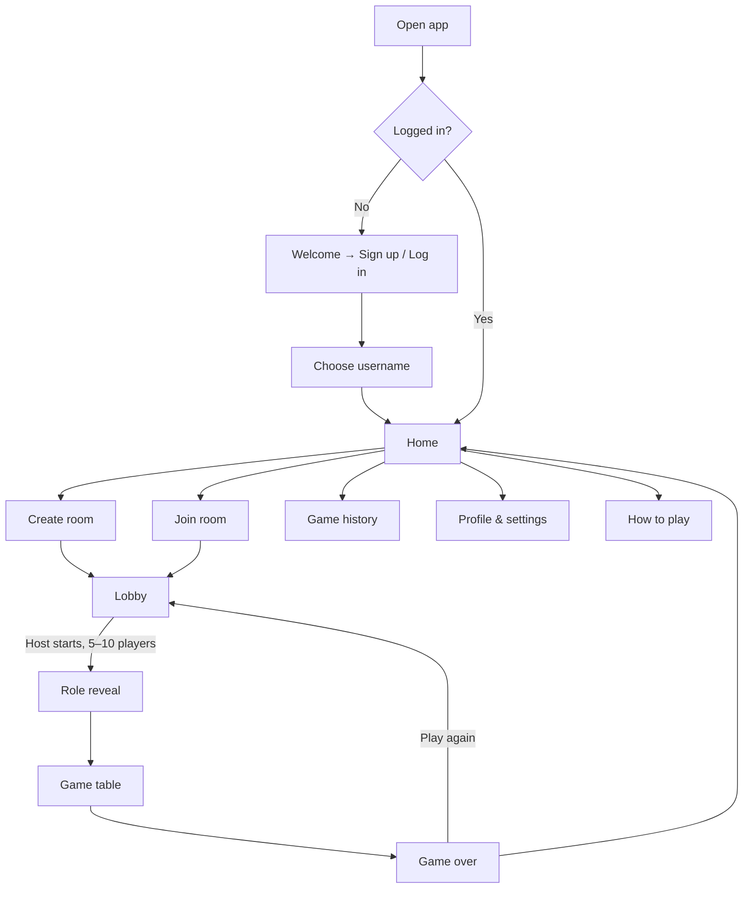
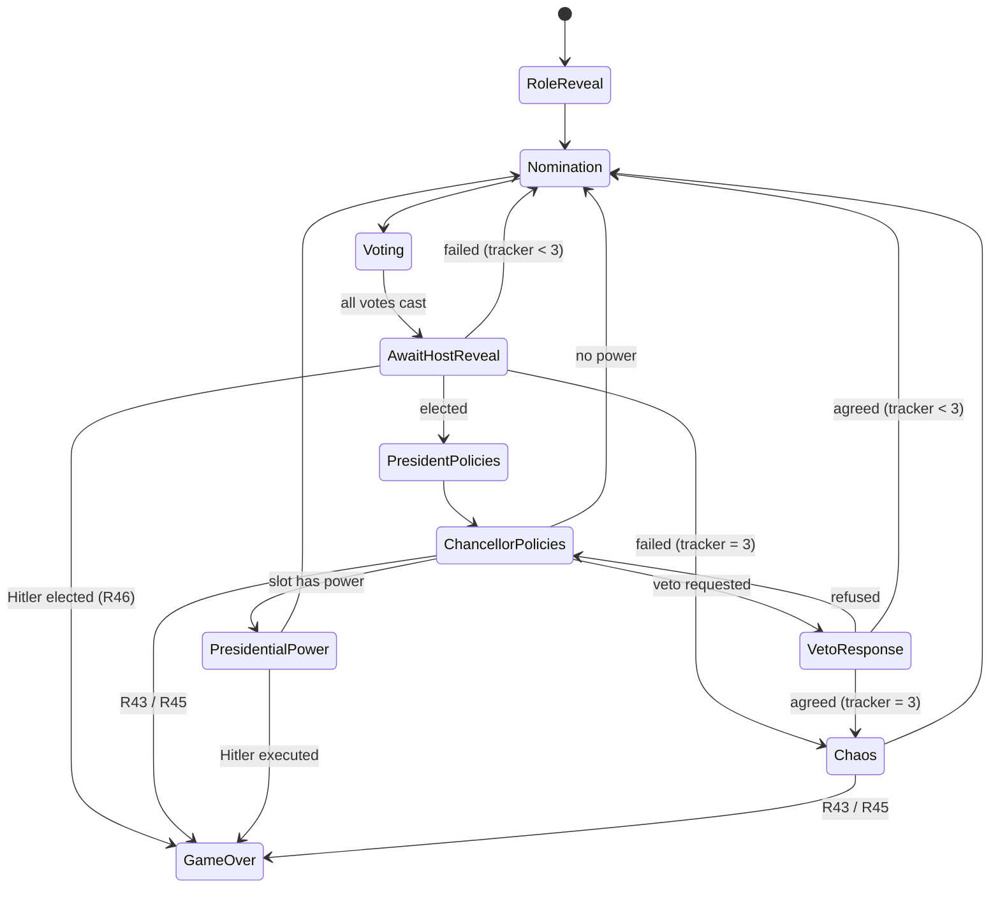

# Secret Hitler Mobile — Specification

**Version:** 0.3 · **Date:** 2026-10-02
**Platforms:** Android + iOS (one codebase) · **Players:** 5–10 humans, no bots

This file says **what** the app does. `plan.md` says **in what order** to build it. `CLAUDE.md` tells Claude Code **how** to work on the repo.

Markers:
- **[DECIDED]** agreed with the owner.
- **[DEFAULT]** used unless the owner changes it.
- **Rule IDs (R1, R2…)** are referenced by tests. Every rule must have at least one test.

---

## Contents
1. Goals & scope
2. Game modes
3. User journey
4. Screens
5. Game rules (rule IDs)
6. Host vote reveal
7. Presidential power screens
8. Who sees what
9. Design brief (owner's taste)
10. Timers, disconnects, host transfer
11. Technical architecture
12. Data model
13. Real-time events
14. Security
15. Licensing
16. Decision log

---

## 1. Goals & Scope

- Friends open the app, create or join a room, and play a full game that follows the official rulebook.
- Two modes: **In-person** (same physical room) and **Online** (different places, with chat).
- The app replaces all physical parts: envelopes, "close your eyes", shuffling, deck, ballots, boards.
- Secret information is never visible to anyone not allowed to see it.
- The look is built from the owner's design brief (§9).

**Not in v1:** bots, matchmaking with strangers, voice chat, spectators, no-internet play.

---

## 2. Game Modes [DECIDED]

| | In-person | Online |
|---|---|---|
| Players | Same room | Different places |
| Talking | Out loud | In-app table chat |
| Phones | One per player | One per player |
| Internet | Required | Required |
| Role reveal, board, votes, policy hands, powers | In the app | In the app |
| Chat | Hidden | Shown |
| Timers | Off [DEFAULT] | On [DEFAULT] |
| Push notifications | Off | On |
| Seat order | Host arranges to match the real table | Shuffled at start |

Online chat is one channel for all living players. There is no private Fascist chat (Fascists never talk in secret in the board game).

---

## 3. User Journey



---

## 4. Screens

Every screen needs: loading, error, no-connection states; works on 360 pt-wide phones and up.

| ID | Screen | Contents & actions |
|---|---|---|
| S1 | Splash | Logo while login status is checked |
| S2 | Welcome | Game name, one-line pitch, "Sign up", "Log in" |
| S3 | Sign up / Log in | Phone, email, Google, Apple [DEFAULT] |
| S4 | One-time code | 6 boxes, SMS auto-fill (Android), resend after 30 s |
| S5 | Choose username | 3–16 chars (letters, numbers, `_`), unique, live availability check; pick avatar |
| S6 | Home | Resume-game banner (if in a room/game) · Create a room · Join a room · Game history preview · How to play · Profile (avatar, top corner) |
| S7 | Create room | Mode (In-person / Online), room password (4–8 chars), settings (timers, chat), "Create room". Server returns a 6-char **Room ID** (no look-alike characters, e.g. `K7M2QX`) |
| S8 | Join room | Room ID + password, "Join room". Errors: no such room, wrong password, room full, game already started. 5 wrong passwords → 5-minute wait |
| S9 | Lobby | Room ID + "Share invite" · seats in order with avatar, username, host crown, ready tick, connection dot · "6 of 10 players, minimum 5" · board preview for current count with its powers · Ready / Leave · Host: reorder seats (In-person), kick, settings, Start game (enabled at 5–10 players, all ready) |
| S10 | Role reveal | Sealed envelope; press and hold to show role card + teammates (R8–R10); release hides; "I've seen my role". Identical layout and animation for every role |
| S11 | Game table | Boards (Liberal track, Fascist track for this count with power icons, election tracker, draw/discard counts) · players in seat order around an oval with badges · status line · action panel · bottom bar: Chat (Online), Log, My role |
| S12 | Vote | Ja / Nein ballots, "Cast vote", voted ticks; host's "Reveal votes" (§6) |
| S13 | Policy hand | President: 3 tiles, choose 1 to discard. Chancellor: 2 tiles, choose 1 to enact, "Request veto" when unlocked |
| S14 | Veto response | President: "Agree to veto" / "Refuse veto" |
| S15 | Power screens | Investigate, Special Election, Policy Peek, Execution (§7) |
| S16 | Chaos | "Three governments failed in a row. The top policy is enacted." + the tile moves to its board |
| S17 | Chat drawer | Online only; system messages inline; muted states (R30, R42); report |
| S18 | Game log | Public round-by-round record; never hidden info |
| S19 | Game over | Winner + reason, all roles, full timeline incl. hidden hands/discards/investigations, "Play again", "Home" |
| S20 | Game history | List (date, mode, players, your role, result, duration) + detail (S19 timeline), simple stats |
| S21 | Profile & settings | Username, avatar, linked logins, notifications, sound, haptics, reduced motion, how to play, credits & license, privacy, report a problem, log out, delete account |
| S22 | How to play | Illustrated step-by-step rules + searchable reference |

**Badges on seats:** President, Chancellor, Nominee, Term-limited, Voted, Executed, Investigated, Not Hitler (confirmed), Host, Disconnected.

**Status line** always says what's happening and who must act, e.g. "Maya is choosing a Chancellor" / "Your turn: choose a Chancellor".

---

## 5. Game Rules

Source: the official rulebook. Items marked **(App rule)** are this app's own additions.

### 5.1 Setup

- **R1** Player count is 5–10.
- **R2** Roles by count:

| Players | Liberals | Fascists (not Hitler) | Hitler |
|---|---|---|---|
| 5 | 3 | 1 | 1 |
| 6 | 4 | 1 | 1 |
| 7 | 4 | 2 | 1 |
| 8 | 5 | 2 | 1 |
| 9 | 5 | 3 | 1 |
| 10 | 6 | 3 | 1 |

  (The uploaded PDF refers to this table but doesn't include it; these are the standard published values — confirm against the physical box.)
- **R3** Party Membership: Liberal → Liberal; Fascist and Hitler → **Fascist**.
- **R4** Policy deck: 6 Liberal + 11 Fascist, shuffled with secure random (Fisher–Yates).
- **R5** Boards are chosen from this **config table** by player count. Code must read powers from the table, never hard-code slot numbers:

| Fascist slot | 5–6 players | 7–8 players | 9–10 players |
|---|---|---|---|
| 1 | — | — | Investigate |
| 2 | — | Investigate | Investigate |
| 3 | Policy Peek | Special Election | Special Election |
| 4 | Execution | Execution | Execution |
| 5 | Execution + Veto unlocked | Execution + Veto unlocked | Execution + Veto unlocked |
| 6 | Fascists win | Fascists win | Fascists win |

  Liberal board: 5 slots, no powers; 5th Liberal policy wins.
- **R6** Seat order = clockwise order. In-person: host arranges in lobby. Online: shuffled at start.
- **R7** First President: chosen at random from all players [DECIDED].

### 5.2 Role reveal knowledge

- **R8** 5–6 players: the Fascist sees who Hitler is; Hitler sees who the Fascist is.
- **R9** 7–10 players: each Fascist sees the other Fascists and Hitler; Hitler sees nobody.
- **R10** Liberals see only their own role.

### 5.3 Election

- **R11** Each new round, the presidency passes clockwise to the next **living** player (unless R12 applies).
- **R12** After a Special Election round, the presidency returns to the player clockwise from the President **who called** the Special Election. No one is skipped; if the chosen player was that next player, they are President twice in a row.
- **R13** Chancellor eligibility — a nominee must be: alive; not the President; not the **last elected Chancellor**; not the **last elected President** (except R14).
- **R14** If 5 or fewer players are alive, only the last elected Chancellor is blocked; the last elected President may be nominated.
- **R15** Term limits come from the last **elected** government (including one that later vetoes), never from failed nominations.
- **R16** Term limits are cleared after Chaos (R23).

### 5.4 Vote

- **R17** Every living player votes, including the President and nominee. Executed players don't vote.
- **R18** Individual votes stay hidden (server only) until reveal; everyone sees who has voted.
- **R19 (App rule)** Votes are revealed when the **host confirms** (see §6).
- **R20** The government is elected only if Ja votes are **more than half of living players**. A tie fails.
- **R21** Failed vote: election tracker +1, presidency moves on (R11).
- **R22** When the tracker reaches 3 → Chaos.
- **R23 Chaos:** the top policy of the draw pile is enacted onto its board; **its power is ignored**; tracker resets to 0; all term limits are cleared; if fewer than 3 tiles remain, shuffle draw + discard into a new draw pile; check wins (R43–R46). Chaos *can* unlock Veto (5th Fascist) and *can* win the game. The next round continues clockwise.
- **R24** The tracker resets to 0 whenever any policy is enacted (by government or Chaos).
- **R25** On a successful election, if **3 or more Fascist policies** are enacted: if the Chancellor is Hitler → Fascists win immediately; otherwise the Chancellor gets a public "Not Hitler" badge.

### 5.5 Legislative session

- **R26** The President receives the top 3 tiles.
- **R27** The President discards 1 by explicit choice. The app offers no random or shuffle option.
- **R28** The other 2 go to the Chancellor together.
- **R29** The Chancellor discards 1 and enacts 1. The enacted tile is shown to all.
- **R30** No communication between President and Chancellor while they hold tiles: in Online mode their chat is disabled; in In-person mode a banner reminds the table.
- **R31** Discarded tiles are never shown during the game (revealed only on the game-over timeline).
- **R32** At the end of every session (including a veto), if fewer than 3 tiles remain in the draw pile, shuffle draw + discard into a new draw pile. Remaining tiles are never revealed.

### 5.6 Veto

- **R33** Veto is available in every session after 5 Fascist policies are enacted (however they were enacted).
- **R34** The Chancellor may request a veto once per session. The President agrees or refuses. If refused, the Chancellor must enact one of the two.
- **R35** If agreed: both tiles are discarded, the tracker +1 (Chaos if it reaches 3), the round ends, presidency moves on.

### 5.7 Presidential powers

- **R36** A power triggers only when a Fascist policy enacted by an **elected government** lands on a slot that has a power (R5). Chaos ignores powers (R23).
- **R37** The President must use the power before the next round. Powers are single-use; they don't stack or carry over. The President may discuss before choosing (out loud or in chat).
- **R38 Investigate:** target is a living player, not the President, not investigated before in this game. Only the President sees the target's **Party Membership** (Hitler shows as Fascist). Everyone sees who was investigated.
- **R39 Special Election:** target is any other living player, including term-limited players. The target becomes the next President and nominates normally; then R12.
- **R40 Policy Peek:** the President privately sees the top 3 tiles in order; order is unchanged.
- **R41 Execution:** target is any other living player. If the target is Hitler → Liberals win. Otherwise the role stays hidden.
- **R42** Executed players cannot vote, chat, be nominated, or be President; rotation skips them; they can still watch public information.

### 5.8 Winning (checked after every enactment, election, and execution)

- **R43** 5 Liberal policies → Liberals win.
- **R44** Hitler executed → Liberals win.
- **R45** 6 Fascist policies → Fascists win.
- **R46** Hitler elected Chancellor after 3+ Fascist policies → Fascists win.
- **R47** Order after an enactment: check R43/R45 **first**; a winning tile triggers no power.
- **R48** The app reveals Hitler automatically in R44/R46 (the rulebook's "must tell the truth" rule).

### 5.9 Round order (state machine)



---

## 6. Host Vote Reveal [DECIDED]

1. Everyone alive taps **Ja!** or **Nein**, then "Cast vote". A cast vote is locked.
2. Seats show a tick when that player has voted. Nobody — including the host — can see how anyone voted.
3. When all votes are in, the host sees **"All 7 votes are in — Reveal votes"**. Everyone else sees "Waiting for [host] to reveal the votes".
4. Host taps "Reveal votes". The server counts, then all ballots flip on every phone at the same moment, followed by the result: "Government elected — 5 Ja, 2 Nein" or "Government rejected — 3 Ja, 4 Nein · Failed elections: 2 of 3".
5. The host can only reveal; the host can't change, see early, or cancel votes.

**Edge cases**
- **Host is executed or leaves:** the reveal duty passes to the next living, connected player clockwise from the host. Their screen shows "You now reveal the votes".
- **Host disconnected > 30 s while all votes are in:** the duty passes the same way until the host returns.
- **Someone won't vote (In-person, no timers):** after 2 minutes the host can tap "Close voting"; missing votes count as Nein and the log says so.
- **Online with timers:** missing votes count as Nein when the vote timer ends; if the host doesn't reveal within 30 s after all votes are in, votes reveal automatically.

---

## 7. Presidential Power Screens

When a power triggers (R36), the game pauses on a **power screen** for the President and a **waiting screen** for everyone else. Which power appears depends on the player count board (R5) — e.g. the 2nd Fascist policy gives Investigate with 7–10 players but nothing with 5–6.

### 7.1 Layout of every power screen (President only)
1. Power icon + name.
2. One-sentence description of what it does.
3. Player list in seat order: avatar, username, badges. Players who can't be chosen are dimmed with the reason ("You", "Already investigated", "Executed").
4. Tap a player → confirmation sheet with the consequence → "Confirm".
5. Chat stays open for everyone (Online) so the table can discuss before the President confirms.

### 7.2 The four powers

| Power | Description on screen | Can't choose | Confirm text | After confirming |
|---|---|---|---|---|
| Investigate | "Look at one player's party membership. You can share it or lie about it." | You, executed, already investigated | "Investigate Arjun?" | Private dossier: "Arjun's party: Fascist" (press and hold to view). Log: "Maya investigated Arjun" |
| Special Election | "Choose the next President. Afterwards the order continues from the player after you." | You, executed | "Make Priya the next President?" | Announcement to all; Priya starts Nomination |
| Policy Peek | "Look at the next 3 policies in the deck. Their order won't change." | (no player list) | — | Private view of 3 tiles in order, "Done" |
| Execution | "Remove one player from the game. If they are Hitler, Liberals win." | You, executed | "Execute Rohan? This can't be undone." | Announcement: "Rohan was executed". If Hitler → Game over; else role stays secret and Rohan's phone switches to the executed view |

### 7.3 Everyone else's waiting screen
"President Maya has a power: **Investigate a player**" + the same description, so every player understands what's happening.

### 7.4 Executed player's view
Greyed table, "You were executed. You can watch, but you can't talk, vote or be chosen." Their own role stays private (still viewable by them).

### 7.5 Board hints
Empty Fascist slots show their power icon. Tapping a slot shows "When a Fascist policy lands here: [power + description]".

---

## 8. Who Sees What

| Information | Everyone | Only… | Nobody until game over |
|---|---|---|---|
| Seats, usernames, alive/executed | ✔ | | |
| Own role | | Self | |
| Teammates | | Per R8–R10 | |
| President, Chancellor, term limits | ✔ | | |
| Who has voted | ✔ | | |
| How someone voted, before reveal | | | Server only |
| Votes after reveal | ✔ | | |
| Enacted policies, tracker, pile counts | ✔ | | |
| President's 3 tiles / Chancellor's 2 tiles | | President / Chancellor | |
| Discards | | | ✔ |
| Investigation target | ✔ | | |
| Investigation result | | That President | |
| Peeked tiles | | That President | |
| Executed player's role | | | ✔ |

**Each phone receives only its own view.** The full game state is never sent to a phone.

---

## 9. Design Brief (owner's taste)

Fill in the "Your choice" column. **Anything left blank uses the default.** Claude Code reads this table to build `packages/theme`.

| Decision | Default ("The Card Table") | Your choice |
|---|---|---|
| 3 mood words | Tense, tactile, period | Premium, cinematic, social (Review 2) |
| Apps/games you like the look of | — | Owner requested references from online games; use original art and a modern game lobby, no copied assets |
| Background | Green baize `#1E3A2F` | Deep charcoal `#101019`, original dossier tabletop art (Review 2; keeps dark mood) |
| Recessed surfaces (sheets, drawers) | `#15291F` | `#151520` |
| Accent (placards, main buttons) | Brass `#C29A4B` | Copper `#E4B982`; ivory primary button with dark text, glass secondary |
| Card / tile paper | `#EDE6D3`, ink `#26323B` | `#F2E9DB`, ink `#1D1B25` |
| Liberal colour + symbol | Blue `#3A6EA5`, round emblem | Blue `#326AA9`, existing round emblem |
| Fascist colour + symbol | Oxblood `#9B2F24`, angular emblem | Crimson `#A8374B`, existing angular emblem |
| Interface font | Jost | |
| Document font (role card, dossier, log) | Libre Caslon Text | |
| Corners | Tiles 10 pt, controls 14 pt | |
| Signature interactions | Hold-to-reveal envelope; drag tile to discard; all ballots flip together | |
| Avatars | Illustrated period portraits (set of 16) | Interim: app-assigned neutral-palette medallion, deterministic per player, until real art exists |
| Sounds | Soft paper/card sounds; off by default | |
| Haptics | Light on selection; one firm on enactment | |
| Theme | One table theme (no light/dark switch) | |

**Fixed rules whatever the taste:**
- Team colour is never the only signal (always a symbol + the word).
- Text contrast meets WCAG AA; touch targets ≥ 44 pt.
- All roles and all private results use identical layout, animation length and haptics.
- Reduced-motion and large-text support.
- No real Nazi symbols.
- Copy in plain sentence case; buttons say exactly what happens ("Nominate Arjun", "Reveal votes", "Execute Rohan").

---

## 10. Timers, Disconnects, Host Transfer

**Timers** (Online on by default; In-person off by default):

| Phase | Time | On timeout |
|---|---|---|
| Role reveal | 60 s | Continue |
| Nomination | 120 s | Random eligible nominee |
| Vote | 90 s | Missing votes = Nein |
| Host reveal | 30 s after all votes | Auto-reveal |
| President's policies | 90 s | Random discard |
| Chancellor's policies | 90 s | Random enact |
| Veto response | 60 s | Veto refused |
| Presidential power | 180 s | Game pauses; host may extend or end the game |

**Disconnects:** the seat is kept; reconnecting phones get their full current view. If the disconnected player must act, their timer pauses up to 2 minutes. After 10 minutes away, remaining players may vote to end the game with no result.

**Host transfer:** in the lobby, host passes to the next player who joined. In a game, only the vote-reveal duty transfers (§6); other host settings are locked once the game starts.

**Background (Online):** push notification when it's your turn; full resync on reopen.

---

## 11. Technical Architecture [DEFAULT]

| Part | Choice |
|---|---|
| Monorepo | pnpm workspaces, TypeScript everywhere |
| Mobile | Expo (React Native), expo-router, Reanimated, Gesture Handler, Zustand |
| Rules engine | `packages/engine`: pure functions, no I/O, Vitest tests |
| Shared types | `packages/protocol`: event names + zod schemas |
| Theme | `packages/theme`: tokens, strings, icons (all user-facing names live here) |
| Server | Node.js, Fastify (REST) + Socket.IO (real-time) |
| Database | PostgreSQL via Prisma |
| Live state | Redis |
| Login | Firebase Authentication (phone, email, Google, Apple); server verifies ID tokens |
| Push | Expo Notifications |
| Builds | Expo EAS (development builds needed once Firebase native auth is added) |
| Local services | Docker Compose (Postgres + Redis) |

The server is the only source of truth: phones send actions, the server validates them with the engine and sends each phone its own view.

---

## 12. Data Model

```text
users        (id, username UNIQUE, avatar_id, created_at)
auth_methods (id, user_id, provider, provider_uid)
rooms        (id, room_code UNIQUE, password_hash, host_user_id, mode, status, settings jsonb, created_at)
room_members (room_id, user_id, seat, is_ready, is_connected, joined_at)
games        (id, room_id, mode, player_count, winner, win_reason, started_at, ended_at)
game_players (game_id, user_id, seat, role, alive)
game_events  (game_id, seq, type, payload jsonb, visible_to, created_at)
```

Room passwords are hashed (argon2).

---

## 13. Real-time Events

**Phone → server:** `room:ready`, `room:reorderSeats`, `room:start`, `role:seen`, `gov:nominate {playerId}`, `gov:vote {ja|nein}`, `gov:revealVotes`, `gov:closeVoting`, `leg:discard {tileIndex}`, `leg:enact {tileIndex}`, `leg:vetoRequest`, `leg:vetoRespond {agree}`, `power:choose {playerId}`, `power:peekDone`, `chat:send {text}`.

**Server → phone:** `room:update`, `game:view` (this player's whole view), `game:log`, `private:info`, `chat:message`, `error {code, message}`.

Every action is validated (phase, actor, target) and returns a clear error on failure, e.g. `INELIGIBLE_NOMINEE: "Arjun was Chancellor last round."`

---

## 14. Security
- Server decides everything; secure random for all shuffles and random picks.
- Automated leak tests: no payload to player X contains another player's role, hand, vote before reveal, discards, investigation or peek result.
- Screenshot blocking on private screens (Android); app-switcher cover (iOS).
- Rate limits: login codes, room passwords, chat, actions.

---

## 15. Licensing
The rulebook states CC BY-NC-SA 4.0: credit Mike Boxleiter, Tommy Maranges and Mac Schubert with a link; no commercial use; share-alike; **no app-store submission without the creators' approval**. App stores also restrict Nazi-related names in some regions. Before store release: get approval, or rebrand (all names/art live in `packages/theme`, so this is a content swap). Not legal advice.

---

## 16. Decision Log

| # | Decision | Status |
|---|---|---|
| D1 | Mobile app, Android + iOS | Decided |
| D2 | Login first; username chosen at sign-up | Decided |
| D3 | Home: create, join, history, profile & settings, how to play, resume | Decided |
| D4 | Host creates room with password; app generates Room ID | Decided / default |
| D5 | 5–10 players; roles and board from player count (R2, R5) | Decided |
| D6 | In-person and Online modes; chat only Online | Decided |
| D7 | Random first President, then clockwise, tracked by server | Decided |
| D8 | Host confirms vote reveal (§6) | Decided |
| D9 | Powers from the player-count board, with dedicated power screens (§7) | Decided |
| D10 | Chaos after 3 failed elections (R22–R23) | Decided |
| D11 | In-person = every player on own phone, internet required | Default |
| D12 | No private Fascist chat | Default |
| D13 | Licensing path (approval vs rebrand) | Open — needed before store release only |
| D14 | Vote ballots labelled Yes/No in English, not Ja/Nein (spec Sec 6, S12 still describe the rule by Ja/Nein for rulebook fidelity - the displayed copy is the English pair) | Decided (Review 1) |
| D15 | Role card heading is always the Team (party membership), the specific role name is the small line underneath - applies to Liberal and Fascist too, not just Hitler, to keep every role card the same layout (CLAUDE.md rule 7) | Decided (Review 1) |
| D16 | S5 "pick avatar" is replaced by "the app assigns an avatar, shown on S5 and never chosen by the player" (Review 1: avatars are assigned by the app). Interim until illustrated portraits exist. Owner to confirm | Decided (Review 1), follows D14/D15 |
| D17 | Review 2: one responsive design on web, installable desktop web, Android and iOS. Original tabletop art, charcoal/copper/ivory palette, polished cards and controls; game text, roles, rules, and private information do not change. Respect reduced motion and no-tells. | Decided (owner request) |
| D18 | Email/password account sign-in uses Firebase once configured. Until then, a clearly temporary demo guest uses a server-issued signed token; client-selected `dev:<name>` tokens are never accepted by the public server. | Decided (owner request) |
